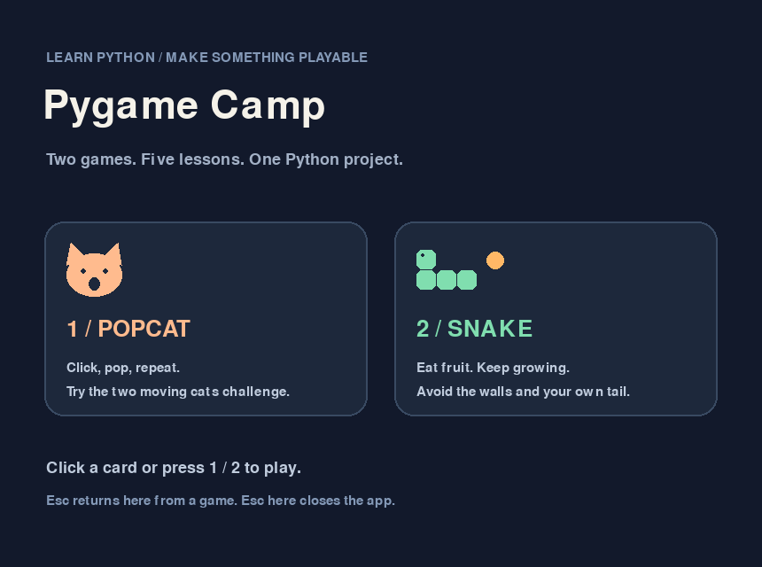
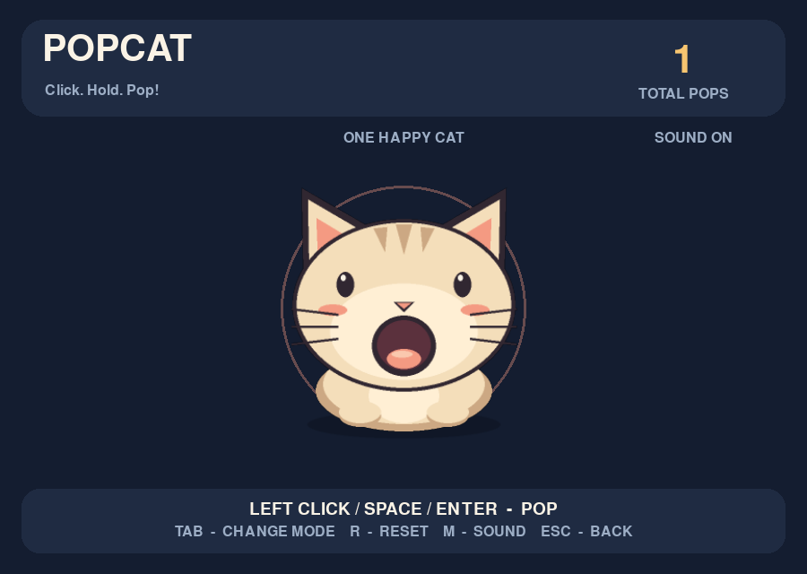
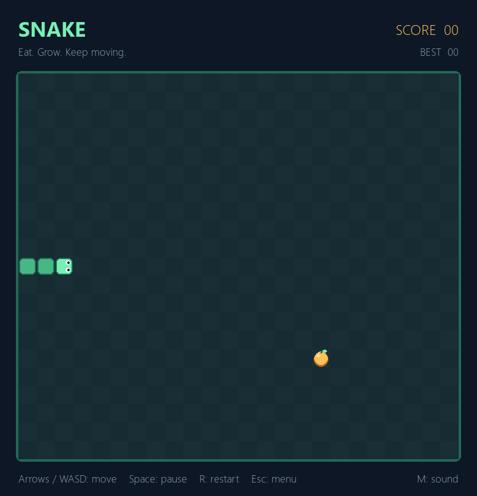

# 2022 Pygame 營隊：完整實作

依照 2022/05/21 營隊講義，完成可直接執行的 Popcat 和貪食蛇，並整理 Pygame、遊戲邏輯與物件導向設計重點。略過變數、運算子、條件與迴圈等 Python 入門教學。



## 需要什麼？

遊戲使用 **Python + Pygame**，圖案和音效由程式產生。Git 用於版本管理與上傳 GitHub。

支援 Python 3.10 以上，建議使用 **Python 3.12**；固定使用 Pygame 2.6.1。請先從 [Python 官網](https://www.python.org/downloads/) 安裝 Python，Windows 安裝時勾選加入 PATH。Pygame 安裝方式可參考 [官方套件頁](https://pypi.org/project/pygame/)。

## 安裝及執行

下載這個 repo 並解壓縮，或用 Git 複製：

```powershell
git clone https://github.com/handsomegary/pygame-camp-2022.git
cd pygame-camp-2022
```

在專案資料夾內執行以下指令。使用虛擬環境可避免套件影響其他專案；以下方式不需要啟用 PowerShell 腳本：

```powershell
py -3.12 -m venv .venv
.\.venv\Scripts\python.exe -m pip install -r requirements.txt
.\.venv\Scripts\python.exe main.py
```

若 `py` 指令不存在，但已安裝 Python 3.10 以上，第一行可改成 `python -m venv .venv`。macOS / Linux：

```bash
python3 -m venv .venv
.venv/bin/python -m pip install -r requirements.txt
.venv/bin/python main.py
```

也可以在已安裝 Pygame 的 Python 環境直接執行：

```bash
python main.py
python main.py --game popcat
python main.py --game snake
```

## 玩法

| 畫面 | 操作 |
| --- | --- |
| 選單 | 滑鼠點選遊戲，或按 `1` / `2`；`Esc` 離開 |
| Popcat | 點擊貓咪，或按 `Space` / `Enter` 張嘴加分；放開閉嘴 |
| Popcat 挑戰 | `Tab` 切換單貓與雙貓移動模式並重設分數；鍵盤操作第一隻貓；`R` 重設分數 |
| 貪食蛇 | 方向鍵或 `WASD` 移動；吃水果加分及增長；碰牆或身體結束 |
| 貪食蛇暫停 / 重玩 | `P` / `Space` 暫停；`Enter` / `R` 重玩 |
| 遊戲中 | `Esc` 返回選單；若使用 `--game` 直接啟動則退出程式 |
| 音效 | `M` 切換靜音 |




貪食蛇沿用講義的 24 × 21 格棋盤、初始長度 3、每秒 10 步。水果不會生成在蛇身上，填滿棋盤會顯示勝利。

Popcat 的單貓模式保留按下／放開動畫和計分，雙貓模式完成講義最後的延伸挑戰。圖案由 Pygame 繪製，短音效由程式產生；沒有音效裝置時仍可遊玩。

## 講義重點整理

[閱讀營隊實作筆記](docs/camp-notes.md)：五份講義的內容去向、事件與畫面更新流程、Popcat 狀態與雙貓挑戰、貪食蛇演算法、物件導向設計，以及講義中需要修正的說法。筆記連結到對應程式，方便邊讀邊看實作。

| 原講義 | repo 保留的內容 |
| --- | --- |
| `pygame__popcat.pdf` | Pygame 視窗、Surface、事件、字型、音效、Popcat 與雙貓移動 |
| `snake.pdf` | 移動節拍、轉彎、蛇身、水果、碰撞、記分、重玩與介面 |
| `Class.pdf` | 實例資料隔離、封裝、繼承與覆寫、可變資料共享陷阱 |
| `PYTHON__part1.pdf` | 與遊戲相關的函式拆分、遞迴終止及迴圈設計；省略入門語法示範 |
| `PYTHON__part2.pdf` | 蛇身與座標資料結構、集合排除、亂數；省略容器操作入門 |

另保留一個短 class 範例，示範獨立實例資料與方法覆寫；只需要 Python 標準函式庫：

```bash
python main.py --example classes
python -m examples.classes
```

## 程式位置

| 檔案 | 內容 |
| --- | --- |
| `examples/classes.py` | class、獨立實例資料、繼承、方法覆寫 |
| `games/popcat.py` | 滑鼠／鍵盤事件、動畫、音效、雙貓移動 |
| `games/snake.py` | 格狀座標、狀態、定時更新、碰撞與水果生成 |
| `main.py` | 圖形選單與命令列入口 |

## 驗證

以下指令使用同一個已安裝 Pygame 的 Python 環境：

```bash
python -m unittest discover -s tests -v
python main.py --smoke-test
```

測試涵蓋遊戲規則及 class 範例；smoke test 使用 SDL dummy driver 短暫繪製兩款遊戲，不會開啟視窗。GitHub Actions 會在 Python 3.10、3.12 上執行上述檢查。

## 來源與素材

實作參考本地五份營隊講義。筆記整理與遊戲實作相關的內容，並非逐頁轉錄；Python 入門概念及其範例已省略。原 PDF 未包含在 repo。貓咪插畫與合成音效為本專案原創，與講義示範截圖的素材不同。

目前原講義來源目錄已不存在；五份 PDF 與講義原本搭配的素材並未保存於本 repo，現階段不能再逐頁核對附件名稱或原始內容。成品遊戲所需檔案完整，但這不表示原營隊教材與附件全部保留。現有原創圖片／音效也不當作教授提供的原素材；詳見 [source-completeness.json](source-completeness.json)。

程式碼採 [MIT License](LICENSE)。Pygame 為獨立安裝的第三方套件，授權見其官方套件頁。
